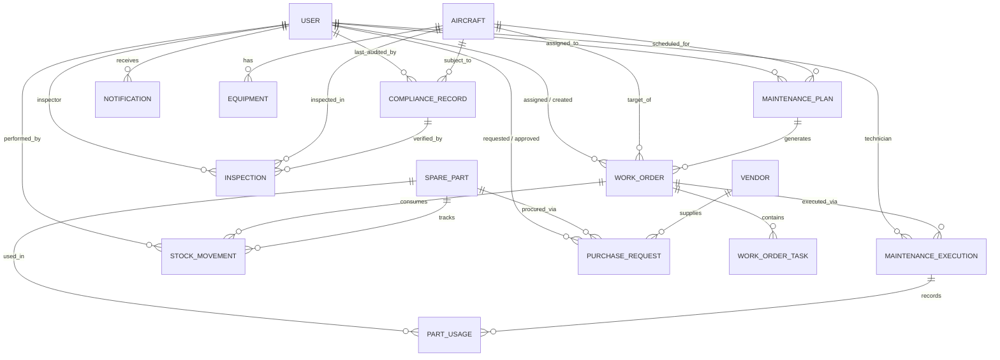

# FlightFix — Database Design Documentation (Supabase PostgreSQL)

## 1. Database Engine & Configuration

FlightFix uses **Supabase PostgreSQL** via Django ORM (`django.db.backends.postgresql` with `psycopg2-binary` and `dj-database-url`).

### Connection Pattern (`backend/config/settings.py`)
```python
DATABASE_URL = os.getenv("DATABASE_URL", "").strip()
if DATABASE_URL:
    DATABASES = {
        "default": dj_database_url.parse(
            DATABASE_URL,
            conn_max_age=600,
            ssl_require=not DEBUG or "supabase" in DATABASE_URL,
        )
    }
```

---

## 2. Entity-Relationship Diagram



---

## 3. Core Tables, Constraints & Indexes

| App | Model / Table | Key Constraints & Indexes |
|---|---|---|
| `accounts` | `User` (`accounts_user`) | `email` UNIQUE, `employee_id` UNIQUE, index on `(role, is_active)` |
| `aircraft` | `Aircraft` (`aircraft_aircraft`) | `registration` UNIQUE, `serial_number` UNIQUE, `flight_hours >= 0`, index on `(status, next_due_date)` |
| `aircraft` | `Equipment` (`aircraft_equipment`) | `serial_number` UNIQUE, FK `aircraft_id` (`CASCADE`), index on `part_number` |
| `maintenance` | `MaintenancePlan` (`maintenance_maintenanceplan`) | FK `aircraft_id`, `frequency_days >= 1`, index on `(status, due_date)` |
| `workorders` | `WorkOrder` (`workorders_workorder`) | `wo_number` UNIQUE, FKs `aircraft_id`, `maintenance_plan_id`, `assigned_technician_id`, index on `(status, priority, due_date)` |
| `workorders` | `WorkOrderTask` (`workorders_workordertask`) | FK `work_order_id` (`CASCADE`), `order >= 0` |
| `inventory` | `SparePart` (`inventory_sparepart`) | `part_number` UNIQUE, `quantity >= 0`, `unit_cost_inr >= 0`, index on `(category, quantity)` |
| `inventory` | `StockMovement` (`inventory_stockmovement`) | FK `part_id`, `quantity >= 1`, atomic update inside `transaction.atomic()` |
| `execution` | `MaintenanceExecution` (`execution_maintenanceexecution`) | FK `work_order_id`, `hours_logged >= 0` |
| `execution` | `PartUsage` (`execution_partusage`) | FK `execution_id`, FK `part_id` (`PROTECT`), `quantity_used >= 1` |
| `compliance` | `ComplianceRecord` (`compliance_compliancerecord`) | Index on `regulation_code`, `status`, `expiry_date` |
| `compliance` | `Inspection` (`compliance_inspection`) | FKs `compliance_record_id`, `aircraft_id`, `inspector_id` |
| `integrations` | `Vendor` (`integrations_vendor`) | `vendor_code` UNIQUE, `rating` 1..5 |
| `integrations` | `PurchaseRequest` (`integrations_purchaserequest`) | `pr_number` UNIQUE, FK `vendor_id` (`PROTECT`), `quantity >= 1` |
| `integrations` | `IntegrationLog` (`integrations_integrationlog`) | `is_simulated` boolean, index on `status` |
| `notifications` | `Notification` (`notifications_notification`) | Nullable `user_id` (broadcast when null), index on `is_read` |
